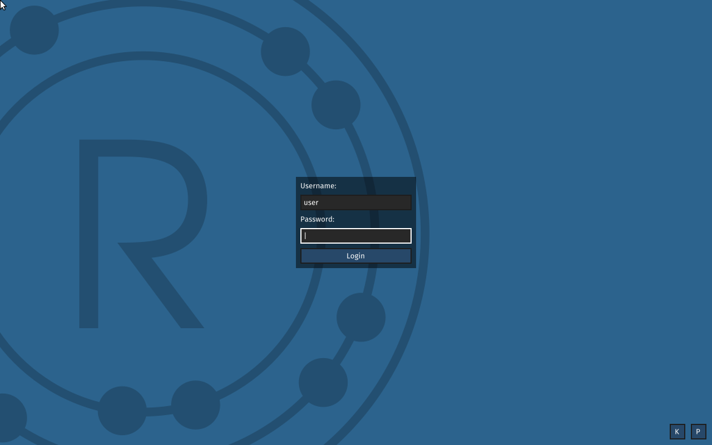
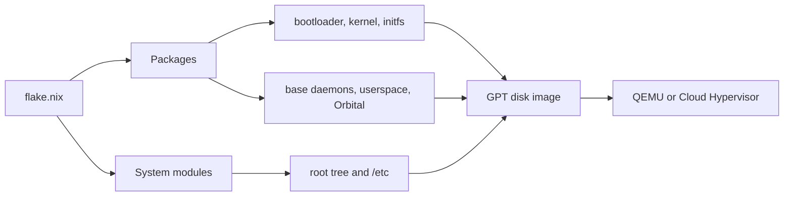

# nix-redox

[](https://github.com/brittonr/nix-redox/actions/workflows/ci.yml)
[](LICENSE)
[](https://nixos.org)
[](https://brittonr.github.io/nix-redox/)

**A complete [Redox OS](https://www.redox-os.org/) distribution, built from source with Nix. One command boots a graphical Redox desktop.**



> **Alpha status.** The VM build/run path, declarative system assembly, on-guest
> `snix` workflows, and self-hosting proofs are exercised. Bare-metal board
> support and some networking paths remain experimental. See
> [`docs/alpha-release.md`](docs/alpha-release.md) for the release gate,
> supported scope, and known limitations.

## Quick start

Requirements: an `x86_64-linux` host with Nix flakes enabled, KVM access
(`/dev/kvm`), roughly 10 GB of disk space, and a graphical display for the
desktop runner.

```bash
nix run github:brittonr/nix-redox
```

The first run builds the full operating system from source. Later runs reuse
cached artifacts. Log in as **`user`** with password **`redox`** (the `root`
account uses the same password).

From a checkout, use `nix run .`. Without a display, use `nix run .#headless`.

```bash
git clone https://github.com/brittonr/nix-redox
cd nix-redox
nix run .                    # graphical desktop (QEMU + GTK)
nix run .#headless           # serial console only (Cloud Hypervisor)
nix run .#run-redox-minimal  # ion shell + uutils
nix run .#run-redox-self-hosting  # includes rustc, cargo and LLVM
```

**Exit:** close the QEMU window (graphical) · `Ctrl+C` (headless) ·
`Ctrl+A X` (QEMU headless).

To run `nix run redox` from any directory, register the checkout once:

```bash
nix registry add redox "git+file://$PWD"
nix run redox
```

### Build the disk image

```bash
nix build              # graphical disk image (default)
nix build .#diskImage  # development image without graphics
```

The result is a GPT disk with a UEFI boot partition and a RedoxFS root
filesystem.

## What you get

| Category | Included |
|---|---|
| **Boot** | UEFI bootloader, kernel, initfs |
| **System** | Redox base daemons and drivers, relibc C library |
| **Shell** | ion (default), bash |
| **Utilities** | uutils, binutils, extrautils, findutils |
| **Editors** | helix, sodium, smith |
| **Networking** | smolnetd TCP/IP stack, dhcpd, ping, nc, curl |
| **CLI tools** | ripgrep, fd, bat, hexyl, zoxide, dust, lsd, bottom, tokei, tree |
| **Development** | gnu-make, git, diffutils, sed, patch, strace |
| **Packages** | snix: Nix evaluation and builds running on Redox |
| **Graphics** | Orbital, orbterm, orbutils, orbdata *(graphical image)* |
| **Self-hosting** | rustc, cargo, LLVM/LLD, cmake *(self-hosting image)* |

## How it works



Every image component is a Nix derivation built from source, with no upstream
Makefile or cookbook in the build path. The build has three layers:

1. **Bootstrap** — relibc, kernel, and bootloader, cross-compiled with
   `-Z build-std` because they provide Redox's standard library.
2. **Userspace** — Rust crates split into per-crate derivations through
   [unit2nix](https://github.com/brittonr/unit2nix) for granular caching. C
   libraries use a clang cross-compiler with relibc as the sysroot.
3. **Assembly** — a NixOS-style module system evaluates the configuration and
   produces the root tree, initfs, and bootable disk image.

External system-layer consumers can target the public substrate surface at
`legacyPackages.${system}.redoxSubstrate`. See
[`docs/redox-substrate.md`](docs/redox-substrate.md) for the manifest, plan
shape, builder shell, and Redox/OnixOS boundary.

### Declarative configuration

Profiles are composable Nix expressions:

```nix
# profiles/my-server.nix
{ pkgs, lib }:
{
  "/environment" = {
    systemPackages = [ pkgs.ion pkgs.uutils pkgs.extrautils pkgs.snix pkgs.redox-curl ];
    etc."etc/motd" = { text = "Welcome to my Redox server!"; };
  };

  "/networking" = {
    enable = true;
    mode = "dhcp";
    dns = [ "1.1.1.1" "8.8.8.8" ];
    remoteShellEnable = true;
  };

  "/users".users.admin = {
    uid = 1001;
    gid = 1001;
    home = "/home/admin";
    shell = "/bin/ion";
    password = "changeme"; # change this before exposing a system
    createHome = true;
  };

  "/services".ssh = {
    enable = true;
    port = 22;
    permitRootLogin = false;
  };

  "/security".requirePasswords = true;
  "/time".hostname = "my-server";
}
```

Profiles compose with `//`: the graphical profile extends the development
profile, which extends the base profile. Search the full option surface with
`nix run .#redox-help -- <query>`, or browse [`docs/options.md`](docs/options.md).

### Managing the system on-guest

Once booted, `snix` manages the running system in the style of
`nixos-rebuild`:

```bash
snix system rebuild            # apply configuration.nix changes
snix system rebuild --dry-run
snix system generations        # list system generations
snix system switch --rollback  # roll back to the previous generation
snix system gc                 # garbage-collect old generations
snix system services           # list declared services
snix install ripgrep           # install a package from the binary cache
```

## Host-side system management

`redox-rebuild` builds configurations and tracks generations on the host:

```bash
nix run .#redox-rebuild -- build
nix run .#redox-rebuild -- switch graphical
nix run .#redox-rebuild -- image graphical
nix run .#redox-rebuild -- export graphical --out redox-graphical.img
nix run .#redox-rebuild -- list-generations
nix run .#redox-rebuild -- rollback
nix run .#redox-rebuild -- run graphical
```

Generations live in `.redox-generations/` (override with
`REDOX_GENERATIONS`). `diff` compares a fresh build with the current
generation, `check` runs assertions, and `--dry-run` plans without recording.
See [`docs/redox-rebuild.md`](docs/redox-rebuild.md) for the boundary with
in-guest `snix system rebuild`.

## Self-hosting

The self-hosting image carries a full Rust toolchain cross-compiled for Redox:

```bash
nix run .#run-redox-self-hosting
```

Inside the guest:

```bash
mkdir hello && cd hello
cargo init
cargo build      # compiles natively on Redox
snix build .#ripgrep
```

The regression suite covers native Rust and Cargo builds, proc-macro loading,
environment propagation, signal delivery, and the system rebuild path. See
[`docs/self-hosting/proof-artifacts.md`](docs/self-hosting/proof-artifacts.md)
for the proof contract and artifact layout.

### Native system rebuilds

`systemSource` selects a guest-local system derivation instead of the Linux
build bridge. Stage `native-system-source-bundle` at `/usr/src/nix-redox` and
`native-kernel-rebuild-bundle` at `/usr/src/native-kernel-rebuild`, then set:

```nix
# /etc/redox-system/configuration.nix
{
  systemSource = "/usr/src/nix-redox/build.nix";
  hostname = "native-redox";
  hardware.networkDrivers = [ ];
}
```

Run `snix system rebuild` normally. The staged graph builds the kernel, UEFI
bootloader, initfs tools, initfs, etc tree, and generation identity on Redox,
offline, and only a successful graph build reaches activation. Generations keep
their boot artifacts and GC roots for rollback.

## Build bridge

Push packages to a running VM without rebuilding a disk image:

```bash
nix run .#run-redox-shared                 # boot with a shared filesystem
nix run .#push-to-redox -- ripgrep fd bat  # push from the host
# inside the guest:
snix install ripgrep
```

## Installing

The supported alpha path is a VM; release images can also be written to USB for
experimental bare-metal boots with `redox-install`. See
[`docs/install.md`](docs/install.md) for verification, USB writing, and the
update story. There is no partition wizard yet.

## Binary cache

The project cache is `nix-redox`:
`https://nix-redox.cachix.org`. The flake declares it in `nixConfig`; CI
publishes images for Nix 2.24.9 and 2.35.1. Store paths are version-dependent,
so use a matching Nix for cache hits; a clean-store run fetches the heavy
components and only assembles the final image locally. See
[`docs/binary-cache.md`](docs/binary-cache.md).

## Testing

Tiered release gates:

| Command | Scope |
|---|---|
| `nix run .#test-quick` | module eval, type, artifact, and library checks |
| `nix run .#test-host` | quick tier plus host tools and snix host tests |
| `nix run .#test-cross` | host tier plus cross-compiled Redox packages |
| `nix run .#test-vm` | fast VM integration: boot, functional, schemes, bridge |

Focused suites remain available when touching their subsystem:

```bash
nix run .#functional-test
nix run .#network-test
nix run .#bridge-test
nix run .#snix-sandbox-test -- --verbose
nix run .#self-hosting-test -- --verbose
```

Run `nix flake check` as the final aggregate gate for a release candidate.
[`docs/alpha-release.md`](docs/alpha-release.md) describes the full checklist
and evidence rules.

## Documentation

- [`docs/alpha-release.md`](docs/alpha-release.md) — alpha scope, gates, known limitations
- [`docs/options.md`](docs/options.md) — generated module options reference
- [`docs/redox-rebuild.md`](docs/redox-rebuild.md) — host-side builds, generations and rollback
- [`docs/binary-cache.md`](docs/binary-cache.md) — Cachix setup, trust and usage
- [`docs/nixos-integration.md`](docs/nixos-integration.md) — NixOS module options and VM service
- [`docs/releases.md`](docs/releases.md) — tag, image assets and verification
- [`docs/install.md`](docs/install.md) — VM, USB writing, verification and updates
- [`docs/porting-packages.md`](docs/porting-packages.md) — Rust and C package porting
- [`docs/home-configuration.md`](docs/home-configuration.md) — data-only per-user files
- [`docs/troubleshooting.md`](docs/troubleshooting.md) — host Nix config, direnv, and headless boot warnings
- [`docs/redox-substrate.md`](docs/redox-substrate.md) — external system-layer API
- [`docs/self-hosting/proof-artifacts.md`](docs/self-hosting/proof-artifacts.md) — proof capture contract
- [`docs/syscall-debugging.md`](docs/syscall-debugging.md) — kernel syscall tracing
- [`docs/bare-metal-lattepanda-mu.md`](docs/bare-metal-lattepanda-mu.md) — experimental bare-metal notes
- [`docs/redox-book/`](docs/redox-book/) — mirrored Redox architecture documentation

## Project status

Supported for alpha:

- `x86_64-linux` hosts with Nix flakes and KVM.
- `nix run .#graphical` (QEMU desktop) and `nix run .#headless` (serial console).
- Disk-image builds, declarative configuration, on-guest `snix system rebuild`,
  generations and rollback, and package install/remove via the build bridge.
- The self-hosting image and guest-native compilation.

Experimental:

- Bare-metal profiles (GMKtec, LattePanda, N100 class hardware).
- I225/I226 networking and netcfg autoconfiguration outside validated hardware.
- `aarch64-linux` outputs unless explicitly validated for a release candidate.

## Community

- [GitHub Discussions](https://github.com/brittonr/nix-redox/discussions) — questions, build reports, package requests, show-and-tell
- [Issues](https://github.com/brittonr/nix-redox/issues) — reproducible bugs and feature requests
- [Security advisories](https://github.com/brittonr/nix-redox/security/advisories/new) — private vulnerability reports

## Contributing

Contributions are welcome. Start with
[`CONTRIBUTING.md`](CONTRIBUTING.md), run `nix develop`, and use the tiered
tests above. Please keep build evidence reproducible and remove local
credentials or machine-specific paths from logs before posting them.

## Security

Report vulnerabilities privately through
[GitHub Security Advisories](https://github.com/brittonr/nix-redox/security/advisories/new)
or `b@robitzs.ch`. Do not open a public issue for an unfixed vulnerability.
See [`SECURITY.md`](SECURITY.md).

## License

This repository is released under the [MIT License](LICENSE). Components built
from upstream projects retain their own licenses; Redox OS is predominantly
MIT-licensed.

## Credits

- [Redox OS](https://www.redox-os.org/) — the operating system
- [adios](https://github.com/adisbladis/adios) — module system
- [snix](https://snix.dev/) — Nix evaluator (patched for Redox)
- [unit2nix](https://github.com/brittonr/unit2nix) — per-crate Nix derivations
